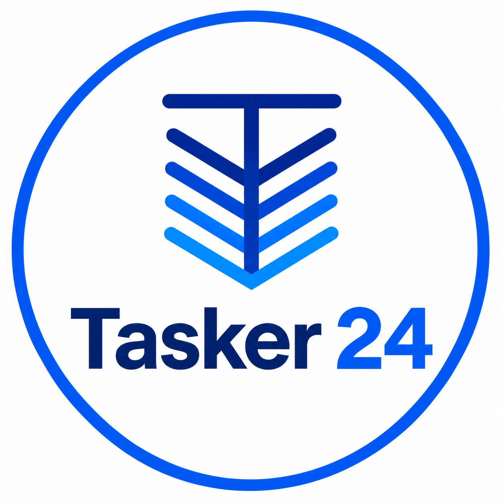

# Tasker 24 Labs

### Practical software. Intelligent automation. Thoughtful engineering.

The software engineering and innovation workspace of **Tasker 24 Solutions**.

**Software Engineering · AI & Automation · Developer Tools · Open Source**

[Explore repositories](https://github.com/tasker24labs?tab=repositories) · [Visit our website](https://www.tasker24.com) · [Get in touch](mailto:info@tasker24.com)

---

## Built around real-world needs

At **Tasker 24 Labs**, we build practical digital products, explore emerging technologies, and share useful tools with the developer community. Our work connects software engineering with intelligent automation to help people and businesses solve everyday challenges.

Based in **Dhaka, Bangladesh**, we bring our applications, experiments, and reusable tools together here on GitHub.

## What we build

| Focus | What we work on |
| :--- | :--- |
| **Software applications** | Web, desktop, and business applications designed around practical workflows. |
| **AI & intelligent systems** | AI-powered applications, agents, retrieval-augmented generation, and assisted workflows. |
| **Automation & integrations** | APIs, connected services, and tools that simplify repetitive work. |
| **Developer tools** | Libraries, utilities, and reusable components that support productive development. |
| **Open source** | Selected projects, examples, and resources to learn from and build upon. |

## How we approach engineering

- **Start with purpose.** Understand the problem and build for clear user value.
- **Build for reliability.** Favor maintainable code, useful documentation, and meaningful tests.
- **Design with care.** Consider security, privacy, and access control throughout development.
- **Use AI responsibly.** Keep human oversight and evaluation central to AI-assisted systems.
- **Improve together.** Welcome constructive feedback and share what is useful.

## Explore & collaborate

Browse our **[public repositories](https://github.com/tasker24labs?tab=repositories&type=public)** for available projects and documentation. Each repository describes its own scope, setup, and contribution process.

Have a bug report, feature idea, or improvement? Start with the relevant repository's README and contribution guidelines, then open an issue or submit a focused pull request where contributions are welcome.

For partnerships, product enquiries, or collaboration, email **[info@tasker24.com](mailto:info@tasker24.com)**.

> **Project availability & licensing:** Our work includes public projects and privately maintained products. Check each repository's license for permitted use; public visibility alone does not grant open-source rights.

### Reporting a security concern

Follow the affected repository's security policy or use private vulnerability reporting where available. If no reporting route is listed, email **[info@tasker24.com](mailto:info@tasker24.com)** to request a private channel. Please keep vulnerabilities, credentials, and sensitive information out of public issues.

---

**Tasker 24 Labs** 
A software engineering initiative of **Tasker 24 Solutions**

[Website](https://www.tasker24.com) · [GitHub](https://github.com/tasker24labs) · [Email](mailto:info@tasker24.com)

Dhaka, Bangladesh

*Build. Innovate. Share.*

